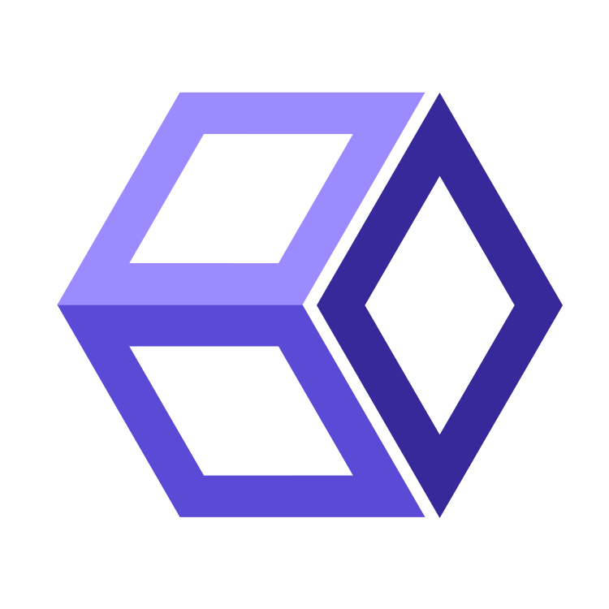

<p align="center">
  
</p>

<h1 align="center">BeatBox</h1>

<p align="center">
  <b>Break the box. Beat the box.</b><br>
  Build a sandbox, break it, see what happens.
</p>

<p align="center">
  <a href="https://github.com/0xthearchitect/beatbox/releases">Download</a> ·
  <a href="#build-it-yourself">Build it yourself</a> ·
  <a href="#license">License</a>
</p>


BeatBox is a lab for hands-on cybersecurity practice that runs on your own
computer. Real machines, real networks, real services. Set them up, attack
them, defend them, and throw them away when you are done.

## Machines

Boot any operating system from an installer disc you already have. Each
machine is a real computer with its own kernel and its own disk, in a
window of its own.

Freeze it. Take a save point before you try something you might want to
undo, and go back to it when it goes wrong. When you are finished, throw
the machine away. The disk you started from is never written to.

## Networks

Cable machines to switches and routers, split them into VLANs, hide them
behind NAT, and give them names and addresses. A firewall decides who may
talk to whom, one rule at a time, top to bottom.

Light PCs and light servers take a megabyte or two each, so a whole office
fits on a laptop next to a few full machines. Then watch it: every
conversation, the way it went through the network, and what the firewall
did to it.

Save a network to a file, or start a new one from a template.

## Servers

Put services to work inside a machine: a website, a site behind nginx, a
PostgreSQL database, an email inbox, names for the whole network. BeatBox
checks what the machine needs before it starts anything, and tells you what
to install when something is missing. Need something else? Describe your
own service.

## Your disks stay yours

BeatBox never downloads a disk, and never writes to the one you give it.
Every machine runs on a layer of its own on top of it, so breaking a
machine never breaks the disk.

BeatBox speaks English and Portuguese.

## Download

Get the installer for your system from
[Releases](https://github.com/0xthearchitect/beatbox/releases).

| System | File |
|---|---|
| Ubuntu 22.04 or newer, Debian 12 | `.deb` |
| Fedora, openSUSE | `.rpm` |
| Any other Linux | `.AppImage` (install QEMU first) |
| Windows 10 and 11 | `-setup.exe` |

The first time it opens, BeatBox checks your computer and offers to fix
what is missing: QEMU, and access to hardware virtualisation (KVM on Linux,
Windows Hypervisor Platform on Windows).

## Build it yourself

You need [Rust](https://rustup.rs) (the version is picked from
`rust-toolchain.toml`), Node.js 20 or newer, and QEMU.

On Ubuntu or Debian:

```sh
sudo apt install build-essential pkg-config libwebkit2gtk-4.1-dev \
    libgtk-3-dev libayatana-appindicator3-dev librsvg2-dev \
    qemu-system-x86 qemu-utils
```

On Fedora:

```sh
sudo dnf install gcc pkgconf-pkg-config webkit2gtk4.1-devel gtk3-devel \
    libappindicator-gtk3-devel librsvg2-devel qemu-system-x86-core qemu-img
```

On Windows, install the
[Visual Studio Build Tools](https://visualstudio.microsoft.com/visual-cpp-build-tools/)
with "Desktop development with C++". BeatBox installs QEMU itself on first
run.

Then, from the repository:

```sh
cd web && npm ci && npm run build && cd ..
cargo build --release -p beatboxd
cargo build --release --manifest-path shell/Cargo.toml
```

Run `shell/target/release/beatbox` (`beatbox.exe` on Windows). It finds the
engine in `target/release/` and starts it.

## License

BeatBox is yours to use under either of

- [Apache License, Version 2.0](LICENSE-APACHE)
- [MIT license](LICENSE-MIT)

at your option.
